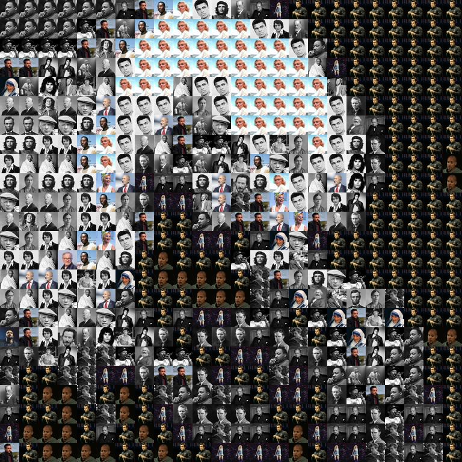
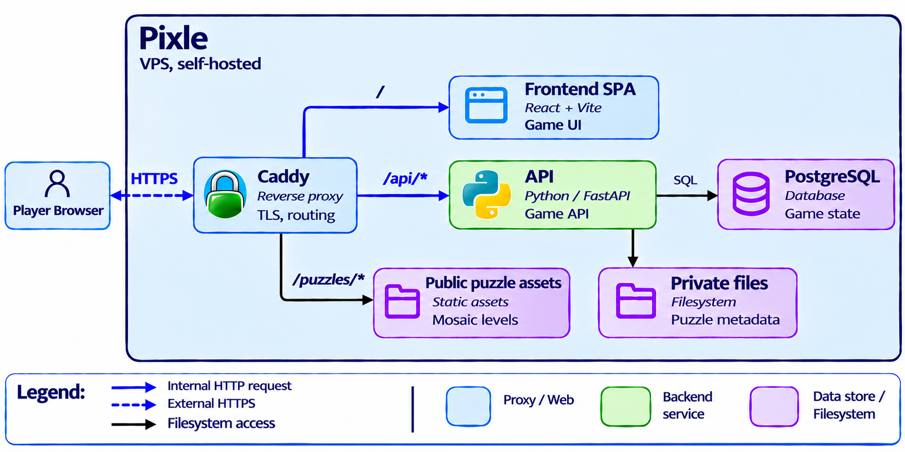
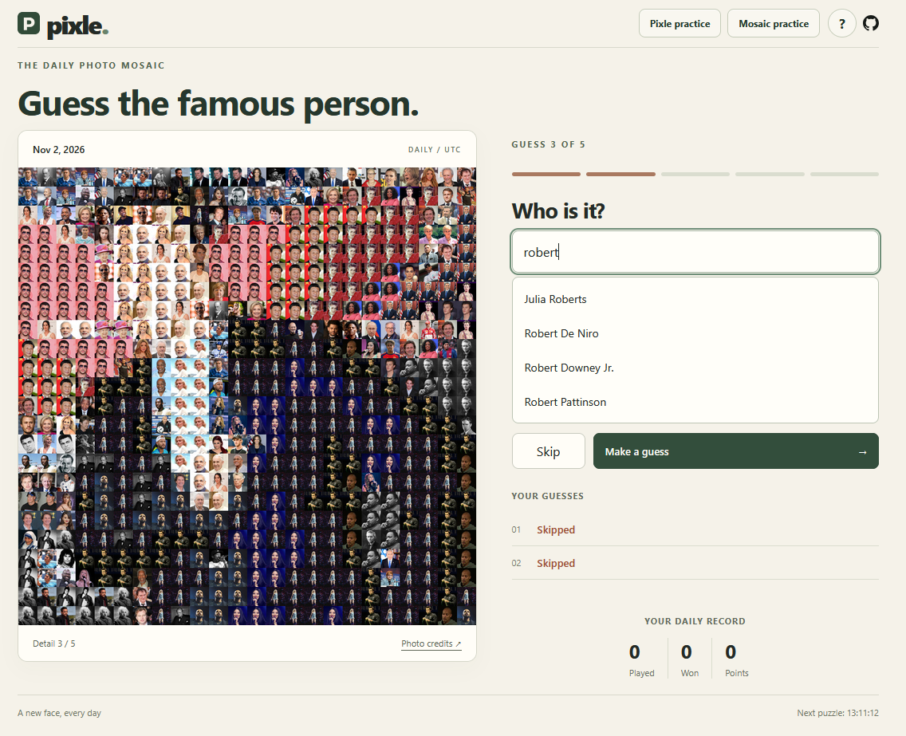
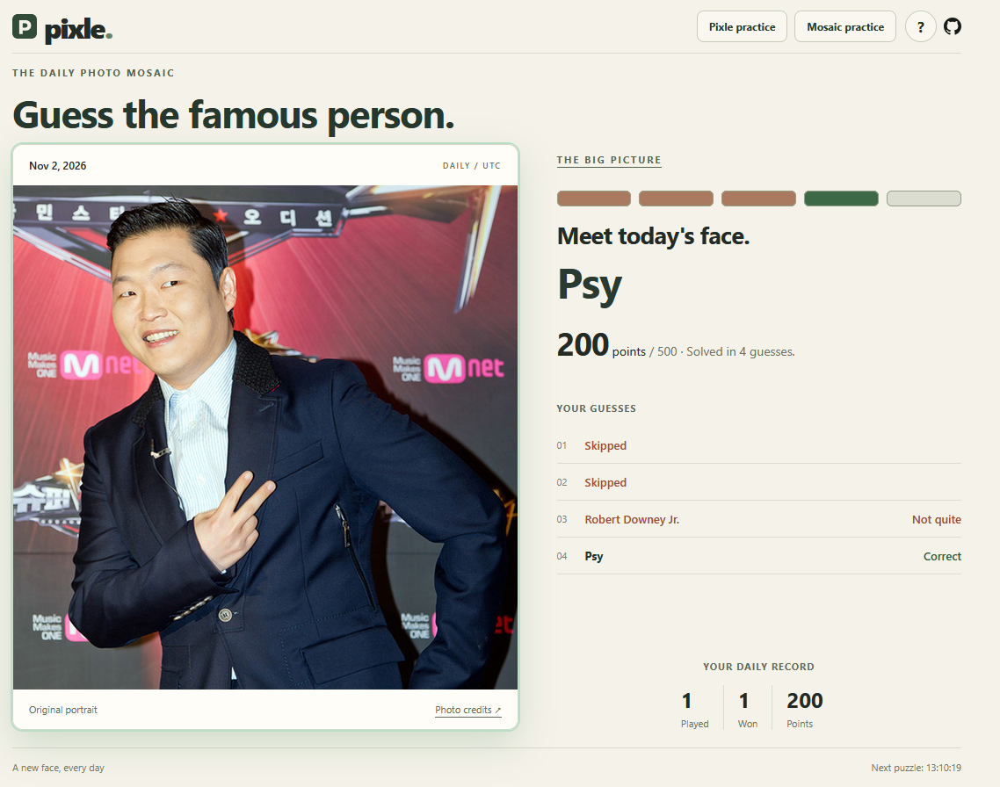

# Pixle

Guess the famous person hidden in a photo mosaic. Five attempts; each wrong guess or skip reveals more detail.

<p align="center">
  
  
  
  <br>
  <em>Albert Einstein at levels 1, 3, and 5.</em>
</p>

**Tip:** Step back to see the face formed by the tiles, not the individual portraits ([Photo credits](puzzles/public/bbde88819742bd384112a358/credits.md)).

One shared puzzle every day at midnight UTC. Solve earlier for more points, or try unscored mosaic and pixelated practice rounds. No signup required.

**Play the game**: https://pixle.duckdns.org

## Application architecture

<p align="center">
  
</p>

Caddy serves public mosaics; FastAPI handles guesses and game state. The API also reads private puzzle metadata and generates pixelated practice images from original portraits.

## Core gameplay flow

1. Browser opens the daily puzzle (`/api/puzzles/daily`) and current progress.
2. Player submits a guess (`/api/puzzles/{date}/guesses`) or skips (`/api/puzzles/{date}/skip`) with an idempotency UUID.
3. Backend validates and persists the attempt atomically in PostgreSQL.
4. UI advances to the next reveal level until win/loss, then shows answer and score.
5. Optional practice rounds run via `/api/practice/*` without affecting daily stats.

## Technology stack

| Area | Technologies |
| --- | --- |
| Frontend | React, TypeScript, Vite |
| Backend | Python, FastAPI, SQLAlchemy, Alembic |
| Data | PostgreSQL |
| Image generation and curation | Pillow, NumPy, OpenCV |
| Delivery | Docker Compose, Caddy, GitHub Actions |

## Key decisions

- **Generate daily mosaics offline:** daily rounds need no image processing. The files are public, so players can bypass reveals by opening finer-level URLs.
- **Keep scoring in the API:** the final attempt and score are saved in one database transaction; retrying the same request UUID does not consume another attempt.

## App demo

The desktop game pairs the mosaic with name suggestions, reveal progress, and guess history.

<p align="center">
  
</p>

After the round, the original portrait, answer, score, and attempt history are shown.

<p align="center">
  
</p>

## Local development

### Prerequisites

- Python 3.12+ (3.13 supported by container image)
- Node.js 22+
- PostgreSQL (for full backend behavior)

### 1) Start backend

```powershell
python -m pip install -r requirements-api.txt
$env:DATABASE_URL = "postgresql+psycopg://<user>:<password>@localhost:5432/pixle"
python -m backend.manage migrate
$env:COOKIE_SECURE = "false"
python -m uvicorn backend.app:create_app --factory --host 127.0.0.1 --port 8000
```

### 2) Start frontend

```powershell
Set-Location frontend
npm ci
npm run dev
```

Open the printed Vite URL. Vite proxies `/api/*` to FastAPI and serves `/puzzles/*` from local public assets.

## Project structure

- [`frontend/`](frontend/README.md) — browser game UI and Playwright tests
- [`backend/`](backend/README.md) — API, session/game logic, persistence, migrations
- [`people/`](people/README.md) — reviewed portrait dataset and provenance metadata
- [`puzzles/`](puzzles/README.md) — generated public/private puzzle assets and versioning
- [`deploy/`](deploy/) — Caddy snippets and backup/restore scripts

## Quality and validation

- Backend tests: `python -m unittest discover -s backend\tests -v`
- Frontend build + tests (from `frontend`):
  - `npm run build`
  - `npx playwright install chromium`
  - `npm test`

CI runs backend tests, frontend build, and Playwright checks on pushes/PRs.

## Production deployment

Docker Compose runs PostgreSQL, FastAPI, and the static frontend on a VPS. Caddy terminates HTTPS and routes `/` to the frontend, `/api/*` to the API, and `/puzzles/*` to public mosaic assets.

GitHub Actions deploys `main` after backend and frontend checks pass. The API applies Alembic migrations on startup.

See [`DEPLOYMENT.md`](DEPLOYMENT.md) for setup, secrets, backups, and restore steps.
